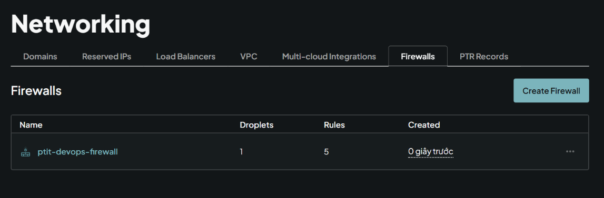

# Bài 4: Cấu hình tường lửa bảo vệ máy chủ (UFW & Cloud Firewall Integration)

## 1. Cấu hình UFW (Lớp 1 - trong OS)

**Các lệnh đã sử dụng để cấu hình UFW:**
```bash
sudo ufw default deny incoming
sudo ufw default allow outgoing
sudo ufw allow 22/tcp
sudo ufw allow 80/tcp
sudo ufw enable
```

**Đầu ra của lệnh `sudo ufw status verbose`:**
```text

# Status: active
# Logging: on (low)
# Default: deny (incoming), allow (outgoing), disabled (routed)
# New profiles: skip
# 
# To                         Action      From
# --                         ------      ----
# 22/tcp                     ALLOW IN    Anywhere                  
# 80/tcp                     ALLOW IN    Anywhere                  
# 22/tcp (v6)                ALLOW IN    Anywhere (v6)             
# 80/tcp (v6)                ALLOW IN    Anywhere (v6)  
```

## 2. Cấu hình DigitalOcean Cloud Firewall (Lớp 2 - Tầng hạ tầng)

Đã tạo một Cloud Firewall trên DigitalOcean và gán vào Droplet. Cấu hình các quy tắc Inbound (chiều vào):
- **SSH (Cổng 22)**: Cho phép từ mọi nguồn (All IPv4, All IPv6) hoặc IP của cá nhân.
- **HTTP (Cổng 80)**: Cho phép từ mọi nguồn (All IPv4, All IPv6).

**Ảnh chụp màn hình cấu hình DigitalOcean Cloud Firewall:**



## 3. Kết quả kiểm tra
- [ ] Đã kết nối SSH thành công.
- [ ] Đã truy cập được HTTP cổng 80 qua trình duyệt.
- [ ] Các cổng dịch vụ không cấu hình khác (ví dụ cổng 8080) đã bị chặn/timeout đúng như yêu cầu.
